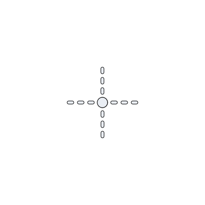
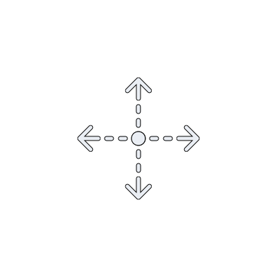
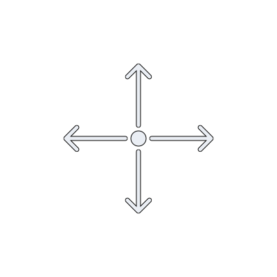
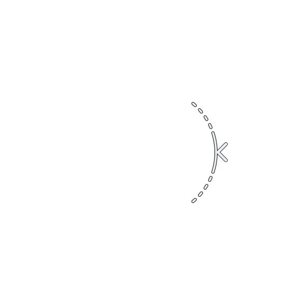
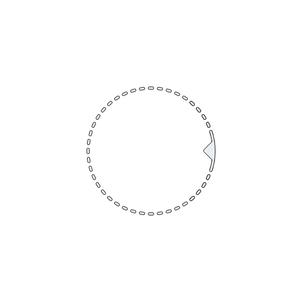
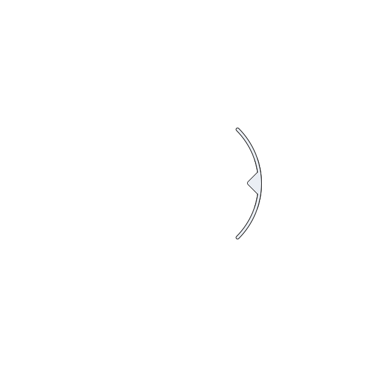
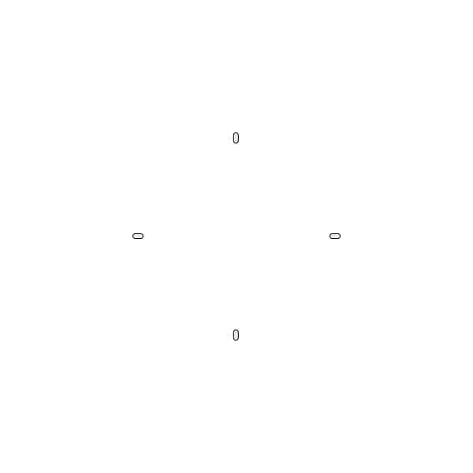

# A visual language for placement handles

Some SolidCraft features are placed on a face of the model: a Rest pad, a Boss, a Snap Fit. Placing one means two things, choosing where it sits on the face and how it is turned. Today both are numbers in a dialog. This note describes handles that let you do both directly on the model, and the visual language they are drawn in. You can try them on a model in the [prototype](./).

This is an early experiment and my current thinking, not a finished design. The prototype is a web page with a simple model; none of it runs in SolidCraft yet, and the real test will be how the handles feel in the app, on real parts.

## Where handles stand

Handles are secondary. You come to the model with something you want to make: a pad that has to sit here, a boss that has to line up with a hole. The model and that intention are what matters, and a handle is only a way to get there. A good handle helps you place the feature and then gets out of the way; it should never pull your attention away from the model or change how you work on it.

That sets the tone for everything below. Handles stay quiet until you reach for them, say only what is needed at each moment, and step back as soon as another part of the work takes over. Their look is designed to be easy to ignore as much as easy to read.

## The problem

A handle sits on top of the model, next to the feature's blue preview, the model's own edges and whatever else the view shows. It has to be found, read and used without a manual. Two handles on the same feature must not be confused with each other or with the preview they control. And the next manipulator SolidCraft adds should be able to use the same visual vocabulary instead of bringing its own.

So the goal was a small set of visual rules that say what can be grabbed, what it will do and what it is doing now, with both handles built from those rules alone. If the rules are right, someone who has used one handle can read the next one without being told.

## The language

Each rule gives one visual element one meaning, and that meaning holds everywhere.

**White with a dark outline** marks something you can grab. Only handles are drawn this way. Everything the app draws about the feature itself, the preview and its footprint, uses the preview's blue. The outline keeps the white readable on the blue preview and on a light model alike.

**A dotted line** is a proposal. It shows what will happen if you act: the directions you can move in, the circle you can turn along. Because it is only a suggestion, it stays light.

**A solid line** is a commitment. When you press and drag, the dotted lines become solid, and the handle shows the action that is under way.

**Detail on request:** at rest a handle shows only enough to be noticed, and pointing at it shows the whole action. The view stays quiet while you work on something else and gives the full picture when you reach for a handle.

**Motion** shows cause and effect. Each animation starts at the part you touch and spreads to what it affects: the move marker's arms grow out of its centre, and the ring's circle unrolls from the grip you are about to drag.

**The shape of a tip** names the kind of motion. An arrowhead means a straight move. A diamond on a circle means a turn. A placed feature has only these two kinds of motion, so two shapes are enough.

## Applying it: the move marker

<figure>

<figcaption>At rest</figcaption></figure>
<figure>

<figcaption>Pointed at</figcaption></figure>
<figure>

<figcaption>Dragging</figcaption></figure>

At rest the marker is a dot with four short dotted arms: a place you can grab and nothing more. Pointed at, the arms grow and end in arrowheads, which says the feature moves straight in any direction along the face. While you drag, the arms turn solid.

During the drag, the feature's footprint follows the pointer as a blue shape on the face. The solid preview takes a moment to be recomputed and catches up behind it. The footprint is blue because it belongs to the feature. It shows where the feature is going before the preview gets there.

## Applying it: the turn ring

<figure>

<figcaption>At rest</figcaption></figure>
<figure>

<figcaption>Pointed at</figcaption></figure>
<figure>

<figcaption>Turning</figcaption></figure>
<figure>

<figcaption>Compass</figcaption></figure>

The ring follows the same rules. At rest it is a short dotted arc with a diamond grip, enough to say that something here turns. Pointed at, the full dotted circle opens from the grip and shows the whole path. While you turn, the arc around the grip is solid.

The ring lies on the face, drawn in perspective, at the same height as the move marker. Moving and turning share one centre, so the two handles read as parts of one placement.

Turning needs a reference that stays put. A compass with short ticks at north, east, south and west stays fixed on the face while the ring turns, so you can see how far you have gone. The grip snaps to those four points when it comes close to one. A feature that may only face one of the four can be limited to them.

## When one handle is in use

Only the handle in use should draw attention. While you move the feature, the ring fades to about a quarter of its strength; while you turn it, the move marker does. The footprint appears only while moving, because turning in place does not need it.

## How it was worked out

The handles began as a spike in the app itself, for the Rest feature. Each change to the drawing meant rebuilding the app, so the work moved to a browser prototype: a small 3D model with the handles drawn from SVG files exported from Figma. A new drawing could be tried in seconds, and sizes, timings and behaviours could be compared side by side.

The prototype is built to show the handles under the conditions they will meet in the app, so that what looks right in it has a fair chance of looking right there:

- **The preview lags on purpose.** In SolidCraft the solid preview of a feature is recomputed in the background and trails the pointer. The prototype holds its preview back the same way (600 ms by default, adjustable) instead of showing an ideal instant update. That delay is the reason the footprint exists, and a prototype without it would hide the problem the footprint solves.
- **The colours are the app's.** The viewport, the body, its edges and the preview blue are SolidCraft's own theme colours, in the dark and the light theme, so judgements about contrast carry over.
- **The model has awkward faces.** A flat top, a slope and a curved boss show how the handles behave when the face is tilted away from the viewer or not flat at all.
- **The drawings are the design files.** The handles are the SVG files exported from Figma, loaded as they are. A changed drawing can be dropped into the page and tried at once, with no translation step in between.
- **The sizes are the app's units.** Sizes are given in screen points, the unit egui uses, so the numbers settled in the prototype can be carried into the app.
- **Alternatives stay switchable.** Timings, scales, snapping and the competing ideas below are settings, so they can be compared side by side instead of being decided once and forgotten.

Several decisions came from trying alternatives there:

- **Flat on the screen or lying on the face.** The move marker stays flat on the screen, so its arrows are always easy to read. The ring lies on the face, because turning happens in the plane of the face and the ellipse makes that plane visible.
- **The footprint in white or in blue.** The first footprint was a white outline. It competed with the handles, so it became a blue shape, and white stayed reserved for things you can grab.
- **Hatching the footprint.** Hatching, as in a section drawing, was considered and left out. It adds texture that slides while you drag, and SolidCraft already uses hatching for section cuts.
- **One crossfade for everything.** A plain crossfade between states hides what is changing. The marker's states now grow out of its centre and the ring's states open from its grip, so each transition shows what the handle does.
- **A ring that changed size as it turned.** An early version measured the ring from the face's directions on screen, and that measure changed with the turn. The ring now keeps its size, because a handle that changes while you hold it feels unstable.

## Beyond these two handles

Two handles for one kind of feature are only a start. A CAD application has many more things you could adjust on the model: distances, angles, radii, the direction of an extrusion, the size of a pattern. The bigger question is whether this language holds up across all of them, or which rules have to change once there are more handles than two.

My guess is that the core carries over. A handle that sets a distance would be a single arrow, dotted at rest and solid while dragging, and a handle that sets an angle would use the diamond, so a new handle would mostly combine what the user has already seen. Whether that is true, and how several handles from different features share one view, is what the next experiments should find out.

## Open questions

- The ring is drawn at the same scale as the marker so their line widths match. On a large feature the ring then sits inside the feature instead of around it. Drawing the circle in code would let its radius follow the feature while the lines keep the marker's widths.
- The app draws its handles with egui, so the final line widths and sizes have to be tuned there, at normal and high pixel density.
